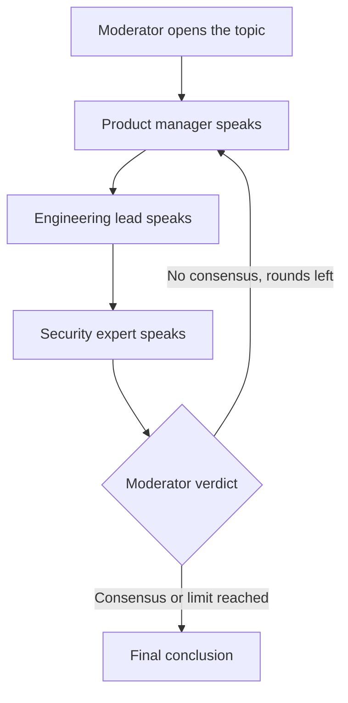

# Ring Roundtable Negotiation

A small, framework-free implementation of the round-robin roundtable pattern. Three expert agents with different stances speak in a fixed order; a moderator opens the topic, keeps the pace, and decides when the discussion is done.

The order is hard-coded, so nobody jumps the queue — that is what separates this from a free-for-all mesh chat. If the moderator is not satisfied after a full circle, another round starts. Otherwise the discussion stops and a conclusion is printed.



## Dependencies


- Python 3.10 or newer (dataclasses and f-strings).
- openai 1.0 or newer, only for the online mode. The offline demo runs without it.
- Nothing else.

## Project layout

```
环形圆桌协商架构/
├── ring_roundtable.py        # Roles, speeches, moderator verdict, termination
├── test_ring_roundtable.py   # Offline smoke tests
├── requirements.txt
├── readme.md                 # English docs (primary)
├── readme_CN.md
└── .gitignore
```

Most things you would want to tweak sit in the constants block at the top:

| Constant | What it does |
| --- | --- |
| `V_最大轮次` | Round cap when consensus is not reached |
| `V_最大发言条数` | Total speech cap, keeps token usage in check |
| `V_离线演示` | True uses built-in mock replies, no key needed |
| `V_接口地址` | OpenAI-compatible endpoint |
| `V_讨论话题` | Demo topic, replace with your own review subject |

## Usage

```powershell
pip install -r requirements.txt
python ring_roundtable.py
```

Offline mode is the default. To hit a real model, flip `V_离线演示` to `False` and export a key:

```powershell
$env:OPENAI_API_KEY="your-key"
python ring_roundtable.py
```

Tests:

```powershell
python test_ring_roundtable.py
```

They cover stance uniqueness, history formatting, moderator JSON fallback, and the full flow — all offline.

### AutoGen equivalent

If you would rather not maintain the turn order yourself, AutoGen's `RoundRobinGroupChat` does the same job:

```python
from autogen_agentchat.agents import AssistantAgent;
from autogen_agentchat.conditions import MaxMessageTermination;
from autogen_agentchat.teams import RoundRobinGroupChat;

team = RoundRobinGroupChat(
    participants=[agent1, agent2, agent3],
    termination_condition=MaxMessageTermination(max_messages=6),
);
```

This repo stays framework-free on purpose: the turn order, stop conditions, and moderator verdict are all visible in one file, which makes debugging a lot less painful.

## Contributing

Open an Issue for bugs, send a PR for changes. A few rules of thumb: keep the stances distinct, do not remove the termination gates, and keep moderator logic out of the domain debate. Run `test_ring_roundtable.py` before submitting.

## Contact

Ailan Anjuxi (谙弆悕博士)

📫 Email: anjuxi.ME@outlook.com

📞 SIP: `sip:anjuxi@sip.linphone.org`

> © 2026 谙弆悕博士（Ailan Anjuxi），All rights reserved.
