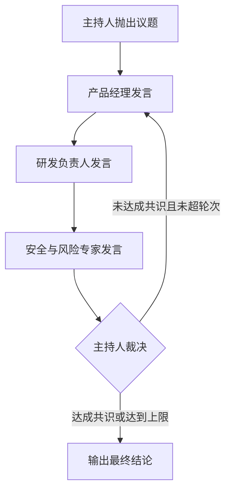

# 环形圆桌协商架构（轮询对等型）

这个仓库是圆桌架构的最小可跑实现，纯 Python，没上 AutoGen 之类的框架。几个立场不同的 Agent 按固定顺序轮流发言，主持人负责开场、控节奏、判断什么时候该收。

流程不复杂：主持人抛议题，产品经理先讲，接着研发、安全，一圈走完由主持人裁决。没谈拢就再来一轮，谈拢或者撞到轮次上限就出结论。发言顺序是写死的，不能插队，这也是它和网状自由群聊最大的区别。



## 依赖说明


- Python 3.10 及以上，用了 dataclass 和 f-string。
- openai 1.0 及以上，只有线上模式才会用到，离线演示不装也能跑。
- 没有别的第三方依赖。

## 项目结构

```
环形圆桌协商架构/
├── ring_roundtable.py        # 主程序：角色、发言、裁决、终止条件
├── test_ring_roundtable.py   # 冒烟测试，离线可跑
├── requirements.txt
├── readme.md                 # 英文说明（主文档）
├── readme_CN.md
└── .gitignore
```

要改的东西基本都在文件开头的常量区：

| 常量 | 说明 |
| --- | --- |
| `V_最大轮次` | 没有共识时最多再开几轮 |
| `V_最大发言条数` | 累计发言上限，防止 token 一路往上飙 |
| `V_离线演示` | True 用内置模拟发言，不需要 Key |
| `V_接口地址` | OpenAI 兼容地址，换自己的服务也行 |
| `V_讨论话题` | 演示议题，随便改成别的评审主题 |

## 使用说明

```powershell
pip install -r requirements.txt
python ring_roundtable.py
```

默认是离线演示，不用配 Key。跑起来大概长这样：

```
第1轮讨论开始！
【产品经理】我主张先做一个最小可用版本……
【研发负责人】技术上两周能做出原型，但……
【主持人裁决】第一轮各方立场都摆出来了，但……
```

接真实模型时，把 `V_离线演示` 改成 `False`，再设环境变量：

```powershell
$env:OPENAI_API_KEY="你的 Key"
python ring_roundtable.py
```

跑测试：

```powershell
python test_ring_roundtable.py
```

测试覆盖角色立场互斥、历史格式化、主持人 JSON 解析降级和完整流程，全程离线。

### AutoGen 对照

不想自己维护轮序的话，AutoGen 的 `RoundRobinGroupChat` 干的就是这件事：

```python
from autogen_agentchat.agents import AssistantAgent;
from autogen_agentchat.conditions import MaxMessageTermination;
from autogen_agentchat.teams import RoundRobinGroupChat;

team = RoundRobinGroupChat(
    participants=[agent1, agent2, agent3],
    termination_condition=MaxMessageTermination(max_messages=6),
);
```

这里没用它，主要是想把轮序、终止条件、主持人裁决拆开写清楚，排查问题的时候不用翻框架源码。

## 贡献指南

有问题直接提 Issue，改代码就提 PR。有几条底线：角色立场别写成一样的，终止条件不能删，主持人逻辑和业务辩论分开。提交前跑一遍 `test_ring_roundtable.py`。

## 联系作者

谙弆悕博士（Ailan Anjuxi）

📫 邮箱：anjuxi.ME@outlook.com

📞 SIP 电话：`sip:anjuxi@sip.linphone.org`

> © 2026 谙弆悕博士（Ailan Anjuxi），All rights reserved。
